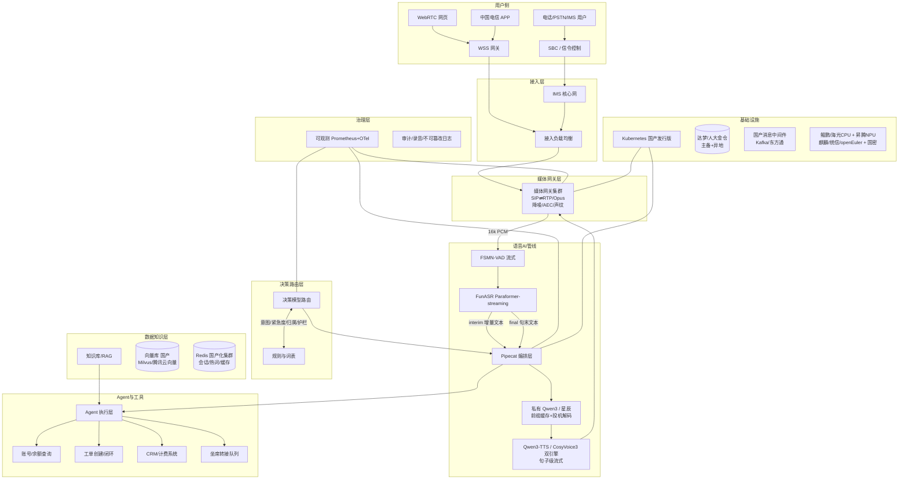
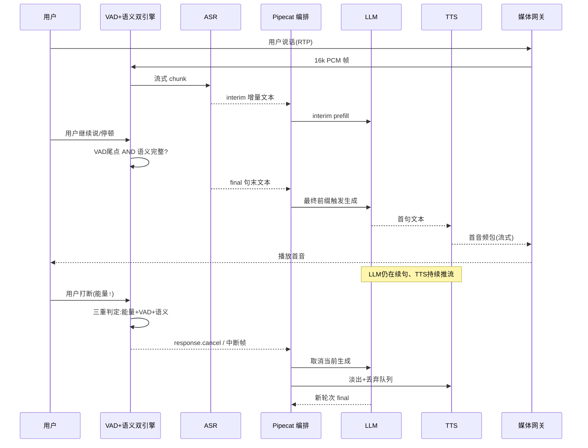

# 中国电信 10000 号私有化信创 AI 语音对话端到端架构方案

## 摘要

本方案的需求口径为**日均千万级 API 调用**（累计调用量，非每秒请求数），据此推导的可立项工程口径为**峰值约 1.1 万会话 QPS、百万级 DAU**。按 100 万 DAU、人均 3 次通话、单次 90 秒估算，日均 AI 调用约 165 万次，峰值并发会话约 6872 路；把单路按 1.5 秒"用户说完—首音频"窗口折算，峰值请求压力约 7000 QPS，叠加 50% 冗余后规划口径取 **1.1 万 QPS**（推导见 §0）。行业参照可信：中国电信已公开万号试点日均处理约 200 万通电话、翼声平台日均 125 万通（公开报道口径），说明百万 DAU 的真实压力落在万级并发而非千万级瞬时请求\[5\]\[11]。

架构主推 **Pipecat（frame 级编排，原生 SIP/WebRTC）+ FunASR 流式 Paraformer + Qwen3-TTS/CosyVoice3 双引擎 TTS + 私有 Qwen3 分层推理 + 自研决策/持久化层**，SIP 与 WebRTC 各做一套预算：WebRTC 目标 P50 800 ms / P95 1350 ms / P99 2200 ms，SIP 目标 P50 1050 ms / P95 1500 ms / P99 2400 ms。100 万 DAU 基线采用鲲鹏/海光 CPU 大规模媒体池 + 昇腾 NPU 峰谷弹性 + 达梦双库（ASR 与 TTS 以 CPU 为主、昇腾为峰谷兜底，LLM 是主要算力消费者）；具体容量与成本数字涉及商务口径，开源版从略。方案不把估算当实测，所有吞吐与成本均为架构估算或 POC 目标值，须在 POC 阶段用真实电信语料回灌标定。TTS 采用**在线主用 Qwen3-TTS + 方言/离线专线 CosyVoice 3.0 + CPU 兜底 MOSS-Nano**的三引擎拓扑（详见 §9）：CosyVoice 3.0 的 18 种以上中文方言覆盖补齐方言客群，其固定话术离线预合成让高频话术做到零推理时延[24]。实时语音大模型方面，国产已进入第一梯队贴身混战（阶跃 StepAudio 3、阿里 Qwen Audio 3.0 Realtime Plus 居 Artificial Analysis 语音推理与对话动力学全球前二），本方案将其列入季度复评跟踪清单，但生产主链路仍坚定采用可观测可降级的级联架构（详见 §9）。

## 0. 需求口径与容量基线定义

**需求口径是"日均千万级 API 调用"，衡量的是累计调用量而非每秒请求数。** 前者是累计调用量，衡量业务体量；后者是每秒请求数，衡量瞬时到达率。语音对话是长连接、长会话业务：一次通话持续数十秒到数分钟，期间音频帧持续流入，既不能把每一帧算作一次 API 调用，也不能把"日调用量"直接等同于"每秒请求数"。语音系统的真正承重指标是**并发会话数（Concurrent Sessions）× 每路媒体带宽**；从调用量到接入侧 QPS 的换算链条是：日均 API 调用 → DAU → 人均日通话 → 通话时长 → 并发会话 → 请求到达率。因此本方案把需求口径明确为**日均千万级 API 调用**，再据此推导可立项的工程口径（并发会话、峰值 QPS、算力与带宽）。

**容量数学：从日均千万级 API 调用推导工程口径。** 取基准假设：DAU 100 万、日活跃率 100%、人均 3 次 AI 通话、每次平均 90 秒、通话集中在 14 小时、峰值系数为平均值的 4 倍（早晚高峰 + 故障报修突发）、AI 自助承接率 55%。日均 AI 调用 = 100 万 × 3 × 55% = 165 万次，属于"日均百万级 API 调用"量级；"日均千万级 API 调用"对应约 600 万 DAU，属扩容档（见下表的 1000 万 DAU 列）。平均并发 = 165 万 × 90 ÷ 86400 ≈ 1718 路，峰值并发 ≈ 1718 × 4 ≈ 6872 路。

再把"并发会话"换算成"请求 QPS"：P95 1.5 秒预算意味着每路在 1.5 秒内贡献 1 次有效请求处理窗口，峰值请求压力 ≈ 6872 ÷ 1.5 ≈ **4581 QPS**，考虑转人工分支、工具重试、音频帧心跳后取 **7000 QPS**，加 50% 工程冗余得到立项规划值 **1.1 万 QPS**。这是会话层等效 QPS，不是音频帧率。

| 指标                 | 公式                        | 100 万 DAU 基线  | 1000 万 DAU 扩容档 |
| ------------------ | ------------------------- | ------------- | -------------- |
| 日 AI 通话量           | DAU × 3 × 55%             | 165 万次        | 1650 万次        |
| 平均并发会话             | 日量 × 90s ÷ 86400          | 1718 路        | 17188 路        |
| 峰值并发会话             | 平均 × 4（高峰集中）              | 6872 路        | 68720 路        |
| 等效请求 QPS           | 峰值 ÷ 1.5s                 | 4581          | 45810          |
| **规划口径（含 50% 冗余）** | —                         | **1.1 万 QPS** | **11 万 QPS**   |
| 日音频输入量             | 165 万 × 90s × 16k × 16bit | 约 400 GB/日    | 约 4 TB/日       |

**基准口径：三层指标分离。** 立项 P0 指标定义为：日均千万级 API 调用、峰值 1.1 万等效 QPS、百万级 DAU；架构设计同时给出"峰值 11 万 QPS、千万级 DAU"的扩容路径（Region 分片：按省/大区 hash、多 AZ 三副本、媒体网关就近接入、控制面与模型面解耦）。这一口径既尊重"千万"的体量感，又让压测、采购、SLA 可量化。

**分层 SLA 定义（必须统一口径，否则 P95 1.5s 无从验收）。**

| 指标            | 定义起点         | 定义终点                       | P50 目标  | P95 目标      | P99 目标  |
| ------------- | ------------ | -------------------------- | ------- | ----------- | ------- |
| TTFS（首字）      | 用户音频尾点       | ASR 首个 interim token 到达编排层 | 250 ms  | 500 ms      | 900 ms  |
| TTFT（首 token） | 最终文本进入 LLM   | LLM 首个输出 token             | 180 ms  | 350 ms      | 600 ms  |
| TTFB（首音频包）    | TTS 收到首个文本句  | 首个可播放音频包离开网关               | 120 ms  | 250 ms      | 400 ms  |
| E2E（端到端）      | 用户说完（VAD 尾点） | 用户听到首音                     | 800 ms  | 1350 ms     | 2200 ms |
| SIP E2E       | 同上           | 同上，含承载网                    | 1050 ms | **1500 ms** | 2400 ms |

所有时延从媒体网关入口打 `mediaTs`、ASR 出口打 `sttTs`、LLM 入口/出口打 `llmInTs/llmOutTs`、TTS 出口打 `ttsOutTs`、网关播放打 `playTs`，全链路以 `traceId` 贯穿，任何一段超预算即触发根因看板。

## 1. 总体架构

**架构原则：媒体下沉、模型池化、控制无状态、状态外置、决策独立。** 媒体处理与 AI 模型放在同一个低延迟域内（同机房、同 AZ，RTT < 0.5 ms），禁止跨城调用；接入与编排无状态可水平扩展；会话状态、工单状态、长时任务状态外置到持久化引擎；轻量决策模型与生成式大模型分层部署，避免每条话都烧一次大模型。

**各层职责与选型理由。** 接入层同时承载 SIP/PSTN/IMS 与 WebRTC/APP 三类入口，SBC 做编解码归一（G.711/PCMU、Opus 24 kbps）和过载保护；媒体网关层做 AEC、噪声抑制、说话人锁定、声纹特征提取，输出 16 kHz 单声道 PCM 到 AI 管线。语音 AI 管线采用 VAD→ASR→LLM→TTS 级联而非端到端 speech-to-speech 直连，理由是级联链路每一段可独立观测、可替换、可降级，对电信业务的可运维性压倒"少一跳"的理论收益。决策路由层与编排层解耦，每条话只调用一次决策模型（< 30 ms 目标）决定走小模型/中模型/星辰大模型、是否走工具、是否直接转人工。Agent 工具层以"读多写少、幂等优先"为第一原则，所有副作用（销户、停机、退款）必须二次确认或授权码。数据层按热度分层：Redis 放会话上下文与热词，达梦/金仓放工单与通话结构化数据，向量库放知识库，对象存储放脱敏后的通话录音。**跨端延伸（Web/App/车载/IoT）**：车载与 IoT 端侧前置唤醒、VAD 与降噪（端侧小模型，复用 §6 模型迁移 B 档的轻量化路径），只把尾点后的有效语音段上云，云端复用同一条 ASR/LLM/TTS 管线——端云协同既降带宽也降云端并发。

**信创基础设施映射。** 鲲鹏/飞腾（ARMv8）承载媒体网关、无状态编排、Redis、Kafka、接入网关；海光（x86 兼容）作为存量 x86 中间件与部分国产化迁移过渡的兜底；昇腾 910B 承载 LLM 推理与峰值期 ASR/TTS 卸载；麒麟 V10/统信 UOS/openEuler 作为 OS 三选二双栈验证；达梦 DM8 作主库、人大金仓 KingbaseES 作备选或按省分库。天翼云 4.0 官方适配中心已明确提供鲲鹏/海光 + CTyunOS/麒麟、飞腾 + CTyunOS 的组合，并支持多种国产 OS、数据库、中间件适配，可作为资源交付底座[14]。

## 2. 延迟预算拆解：1.5 秒怎么来的

**1.5 秒不是"加起来刚好 1.5"，而是给每一跳留死线、总和不许超 1.5。** 核心优化思想是"任何两段不能串行就并行"：VAD 尾点尚未确认时 ASR 已在出 interim 文本，LLM 已在用 interim 做 prefill，TTS 已在收到第一个完整短句时出首包。

### WebRTC 预算（目标：P50 800 / P95 1350 / P99 2200 ms）

| 段                           | P50     | P95      | P99      | 优化手段                         |
| --------------------------- | ------- | -------- | -------- | ---------------------------- |
| 客户端采集+编码                    | 40      | 80       | 150      | Opus 20ms 包长、固定采样            |
| 网络传输（RTP 上行）                | 30      | 60       | 120      | 同 Region 接入、预建连              |
| 网关 AEC/降噪/重采样               | 10      | 20       | 40       | 算子融合、ARM NEON                |
| VAD 尾点等待                    | 250     | 400      | 700      | 300ms 静音尾点、韵律判停兜底            |
| ASR 首字（interim）             | 120     | 250      | 450      | 600ms chunk、缓存复用、INT8        |
| LLM TTFT（用 interim prefill） | 120     | 250      | 450      | 前缀缓存、chunked prefill、小/中模型路由 |
| 句子切分等待                      | 40      | 80       | 150      | 边到边标点、语义完整度判停                |
| TTS TTFB                    | 80      | 150      | 250      | 句子级流式、双轨混合架构                 |
| 网络传输（音频下行）                  | 30      | 60       | 120      | 同上                           |
| 客户端 jitter 缓冲+播放            | 80      | 120      | 200      | 动态缓冲、首包立即开播                  |
| **合计**                      | **800** | **1350** | **2200** |                              |

### SIP 预算（目标：P50 1050 / P95 1500 / P99 2400 ms）

| 段                   | P50       | P95              | P99       | 说明             |
| ------------------- | --------- | ---------------- | --------- | -------------- |
| 电话承载网（PSTN/IMS/SBC） | 120       | 220              | 400       | SIP 多一跳、运营商网抖动 |
| SBC/网关处理            | 15        | 30               | 60        | 编解码、DTMF 处理    |
| AEC/降噪/声纹           | 10        | 20               | 40        | 电话回声路径复杂       |
| VAD 尾点              | 250       | 400              | 700       | 同 WebRTC       |
| ASR 首字              | 120       | 250              | 450       | 同上             |
| LLM TTFT            | 120       | 250              | 450       | 同上             |
| 句子切分                | 40        | 80               | 150       | 同上             |
| TTS TTFB            | 80        | 150              | 250       | 同上             |
| 回传承载网               | 120       | 220              | 400       | SIP 下行多一跳      |
| 播放缓冲                | 100       | 150              | 250       | 电话侧缓冲略长        |
| **原始合计**            | **975**   | **1770（超标 270）** | **3150**  | 原始链路、不加降级      |
| **降级后承诺**           | **≤1050** | **≤1500**        | **≤2400** | L1/L2 降级兜底后的上限 |

SIP 预算在 P95 下超标约 270 ms，故设计两档降级：**L1 降级**（工具调用慢）触发 TTS 先播"正在为您查询"，把 E2E 拆成"首包+信息包"两段，用户感知不空转；**L2 降级**（LLM 超时 800ms）用规则模板句直接回，保住 1.5 秒红线。这意味着"P95 1.5 秒"的承诺值是降级兜底后的上限，正常链路目标仍是 1.35 秒。

**六段优化手段逐个落地。**

1. **流式重叠（streaming overlap）**：ASR 每 600 ms 出一次增量文本，编排层立即把 interim 送 LLM 做**投机 prefill**，不等 final。注意 interim 文本不稳定（后续 chunk 会改写前面的字），final 到达后须校验前缀一致性：命中（目标 40–60%）则复用已算 KV，不命中丢弃重算——真正稳定的收益来自系统提示词 prefix cache，interim 投机只是增量收益。FunASR 官方实时听写链路正是"FSMN-VAD-realtime → Paraformer-online"，VAD 尾点间隔 600 ms、识别文字间隔 600 ms[3]，与本方案 chunk 策略一致。
2. **interim 提前触发**：首句小于 4 字直接放行，大于 4 字等标点或韵律边界；用"语义完整度"而非"长度"判停，避免句子切半。
3. **Prefix cache**：系统提示词、角色设定、业务场景模板常驻 KV，命中率目标 > 85%，TTFT 下降 30–50%。vLLM-Ascend v0.9.1 已正式支持 automatic prefix caching 与 chunked prefill[16]，是昇腾侧可行路径。
4. **句子级 TTS**：不做整段文本合成，以标点/意群切句，首句到达即开播；Qwen3-TTS 的 dual-track 混合流式架构首包可至 97 ms[9]，是本方案首选。CosyVoice 3.0 的双向流式（文本流入 + 音频流出）官方口径首包 150 ms[24]，不进在线主链路，改由方言专线与固定话术离线预合成承接——命中即播，推理时延归零。
5. **投机解码/小模型预热**：高并发峰期对中模型启用 MTP 式投机解码，首 token 加速 20–80%；vLLM-Ascend 已支持 Ngram 与 MTP 投机解码[16]。
6. **打断检测前置**：用户侧能量 + VAD + 语义 turn detection 三重判停，模型生成中的尾音用"快速淡出 + 早停"而非硬切，避免爆破音。

## 3. 容量模型与资源估算

**估算口径说明：下表全部为架构估算，非官方实测；ASR/TTS 单实例吞吐取生产工程经验值（FunASR 流式 GPU 百路级、MOSS-TTS-Nano 纯 CPU 千路级），须以电信真实方言/噪声语料 POC 校准。**

### 会话并发 → 模型并发换算（占空比模型）

**模型层容量不按会话并发全量计，而按"占空比"折算——一路 90 秒通话里，各模型真正在烧算力的时间占比远小于 1。** 基准假设：单通 90 秒、约 6 轮对话；用户说话合计约 30 秒（33%）；LLM 生成合计约 15 秒（每轮约 2.5 秒，17%）；AI 播报合计约 45 秒（50%），TTS 算力占用 = 播报时长 × RTF（≈0.3）。

| 模型层       | 并发折算公式                    | 峰值并发（架构估算） |
| --------- | ------------------------- | ---------- |
| ASR       | 6872 × 说话占比 33%           | ≈ 2270 路   |
| LLM（合计）   | 6872 × 生成占比 17%           | ≈ 1170 并发  |
| ├ 小模型 40% | 1170 × 40%                | ≈ 470 并发   |
| ├ 中模型 50% | 1170 × 50%                | ≈ 585 并发   |
| └ 大模型 10% | 1170 × 10%                | ≈ 117 并发   |
| TTS       | 6872 × 播报占比 50% × RTF 0.3 | ≈ 1030 并发流 |

接入网关与媒体网关按会话并发全量计（6872 × 1.5 = 10308 路），模型层按上表折算。占空比假设（6 轮、各段时长、RTF）须在 POC 用真实通话回灌标定——这是全部卡数推导的地基。

### 100 万 DAU 基线资源表

| 组件                                    | 容量假设                                 | 单实例规格                 | 说明                                   |
| ------------------------------------- | ------------------------------------ | --------------------- | ------------------------------------ |
| 接入网关（SBC/WSS）                         | 1.1 万 QPS 等效会话                       | 8C16G 鲲鹏              | 无状态，2N+2 冗余                          |
| 媒体网关                                  | 峰值 6872 路 × 1.5 冗余 = 10308 路         | 16C32G 鲲鹏 + 1×NPU（可选） | AEC/降噪吃 CPU，ARM NEON 优化              |
| ASR（FunASR Paraformer-streaming INT8） | 峰值约 2270 路并发（说话占空比 33%），GPU RTF 0.01 | 1×昇腾 910B / 32 路      | 常态鲲鹏 CPU 10 台 32C；峰谷切昇腾 16 卡卸载 512 路 |
| LLM 小模型（Qwen3-4B/7B 类，意图与兜底）          | LLM 总并发约 1170 × 40% ≈ 470 并发         | 1×昇腾 910B / 64 并发     | INT4/INT8 量化，prefix cache            |
| LLM 中模型（Qwen3-14B/32B，主答）             | LLM 总并发 × 50% ≈ 585 并发               | 1×昇腾 910B / 32 并发     | 主算力消费者                               |
| LLM 大模型/星辰（复杂推理，10%）                  | LLM 总并发 × 10% ≈ 117 并发               | 2×910B（TP=2）/ 16 并发   | 仅疑难/工单复杂场景                           |
| TTS（Qwen3-TTS 1.7B）                   | 峰值约 1030 并发流（播报占空比 × RTF）            | 1×昇腾 910B / 128 流     | 常态与峰值混部，0.6B/1.7B 按音色分档              |
| TTS 兜底（MOSS-TTS-Nano 0.1B）            | 10% 流量降级                             | 16C32G 鲲鹏 / 200 路     | 纯 CPU，48 kHz 双声道                     |
| TTS 方言/离线专线（CosyVoice 3.0 0.5B）    | 10% 方言流量 + 全部预合成任务                | 1×昇腾 910B / 96 流 或鲲鹏 32C | 18+ 中文方言、拼音/音素定点改读[24]；固定话术离线渲染，命中即播 |
| Redis 集群（国产化）                         | 会话 10308 × 256KB ≈ 2.6 GB 热数据        | 3 主 3 从               | 会话上下文、限流计数                           |
| Kafka                                 | 峰值 1.1 万 msg/s，留存 24h                | 3 broker 跨 3 AZ       | 通话事件、审计、工单异步                         |
| 向量库                                   | 知识条目 500 万 × 1536 维                  | 3 分片 2 副本             | 工单/FAQ 检索                            |
| 达梦 DM8                                | OLTP 165 万写/日 + 工单                   | 主备 + 异地               | 等保四级、国密、三权分立                         |

**ASR 资源推导**：FunASR 流式 Paraformer 官方口径为 GPU 下推理效率提升约 10 倍、可支持上百路并发[3]；架构估算取 1 张昇腾 910B 承载 32 路实时 ASR（RTF≈0.01，留 3 倍安全余量）。峰值约 2270 路并发若全量 NPU 需数十卡量级，成本不可接受，故采用**CPU 常态 + NPU 峰谷弹性**：鲲鹏 32C 实例按 RTF 0.05 计单实例可承载约 640 路，常态数实例即可，按 2N+2 冗余部署；峰期叠加少量昇腾卡卸载数百路突发流量（承接突发与 CPU 池抖动）。**峰谷切换不迁移存量会话**：新会话路由到 NPU 池，旧会话在 CPU 池自然消退。这一取舍是本方案最关键的 TCO 决策。

**LLM 资源推导**：LLM 并发不等于会话并发——按占空比折算后总并发约 1170（见上换算表）。中模型 Qwen3-32B 类，INT8 量化每卡显存占用约 40–50 GB（含 KV cache 按 8K 上下文、并发 32 路），昇腾 910B 64 GB HBM2e 单卡放 1 份并承载 32 并发；中模型按每卡 32 并发折算约 20 卡内，加 25% 冗余取整；小模型与大模型同理按并发 ÷ 单卡并发折算后取整（含冗余）。KV cache 显存是主要约束：每路每 token 约 2×层数×隐维字节数，32B 模型在 8K 上下文下单路 KV 约 1.5 GB，故必须靠 prefix cache + 上下文截断（业务对话截断到最近 6 轮）控制。**诚实边界：32B 单卡 32 并发下 P95 TTFT 250 ms 属进取目标，POC 须同步验证 PD 分离；达不到则中模型降档 14B、以延迟达标为优先。**

**TTS 资源推导**：TTS 的算力占用不是"播报时长"而是"播报时长 × RTF"——Qwen3-TTS 1.7B 流式首包 97 ms[9]，架构估算 RTF≈0.3、单卡 128 并发流；按单卡 128 流折算后加 25% 冗余取整。MOSS-TTS-Nano 仅 0.1B、原生 48 kHz 双声道、纯 CPU 可运行[8]，作为声卡故障/昇腾拥塞时的兜底，保证 TTS 永不成为单点。CosyVoice 3.0（0.5B）与 Qwen3-TTS 构成在线互备：在线主链路追求 97 ms 首包，CosyVoice 承担方言专线与离线预合成缓存，任一引擎 P95 TTFB 超 300 ms 自动互切，同时切走一路近百流的峰值负荷，等于给在线池加了一层弹性。

**消息/缓存/存储**：Kafka 按峰值 1.1 万 msg/s、每条 2 KB 估算写入 22 MB/s，3 broker 每节点 8C16G 足够；Redis 热数据按每路会话上下文 256 KB 上限计（构成：ASR 增量文本约 20 KB + 最近 6 轮对话历史约 30 KB + 槽位/工具结果约 60 KB + 声纹特征与缓冲指针约 20 KB + 余量）≈ 2.6 GB，加 5 倍 TTL 余量取 16 GB 主节点；录音对象存储按 165 万通 × 90 s × 16 kbps ≈ 每天 300 GB，30 天留存 ≈ 9 TB，去重/降采样后可压至 5 TB。

### 1000 万 DAU 扩容档（水平分片，不做垂直堆卡）

| 组件 | 扩容策略 | 资源量（架构估算） |
|---|---|---|
| 媒体/ASR/TTS | 按省/大区 hash 分片，每片承载 ≤ 2 万路 | 10 个 Region × 上述资源量 |
| LLM | Prefill 与 Decode 分离，跨 Region 模型路由 | 昇腾集群千卡级，PD 分离 |
| 控制面 | 多 AZ、每 AZ 独立故障域 | 3 AZ × 2N |
| 数据面 | 达梦主备 + 异地三中心，向量库按租户分片 | 每中心 2 套主备 + 1 异地 |

扩容核心不是"多买卡"，而是**把长连接会话钉死在单一 Region**：用户接入后通过一致性 hash 绑定到固定媒体网关与 AI 管线组，禁止跨城迁移会话；模型池跨 AZ 共享但媒体池不跨城。

## 4. 全双工与打断设计

**双引擎判停：VAD 管"声音停没停"，语义 turn detection 管"话说没说完"。** 单靠 VAD 的 300–800 ms 静音尾点会白白吃掉用户时间（行业基准：VAD 尾点是最大单一延迟来源之一）；单靠语义判停则会被"嗯""啊""这个……"拖住。方案是 FSMN-VAD 出候选尾点后，轻量语义模型在 50 ms 内判断是否句末完整，二者 OR 逻辑：VAD 尾点超时 400 ms 或语义判停成立，即触发 final。**尾点阈值按场景分档**：高信噪比 WebRTC 用 300 ms 激进档，电话报修与老人专线用 500–600 ms 保守档（宁慢勿抢，误截断比多等 200 ms 更伤体验）；阈值不进代码进配置，由 badcase 回流每周校准。打断时反向：用户能量超阈值 + VAD 持续 200 ms + 语义判定为"新意图发起"三者 AND 成立才认定为真打断，避免咳嗽、呼气被误判。

**打断信令走标准协议，自研层只做幂等。** Realtime 模式使用 OpenAI Realtime 兼容事件集，支持 `input_audio_buffer.speech_started / speech_stopped` 与 `response.cancel`[6]；Pipecat 原生支持 interruption handling、turn detection 与 frame 级中断[4]。编排层收到中断帧后，向 LLM 发取消、向 TTS 发"淡出后清空音频队列"、向工具层发"标记本轮副作用待补偿"，整条链 200 ms 内收敛。

**工具调用期禁打断是非协商项。** 已发起销户、停机、退款、密码重置等非幂等写操作时，TTS 播放"正在为您办理，请勿打断"，同时开启禁打断窗口（最长 8 秒）；窗口内用户音频只进入缓冲不触发新轮次。读类操作（查余额、查套餐）可打断，但需做结果合并，避免打断后重复播报。

**声学侧：AEC + 噪声抑制 + 说话人锁定。** SIP 侧回声路径复杂，必须做线路回声消除（LEC）+ 声学回声消除（AEC）；WebRTC 走 `echoCancellation: true` 内置处理。背景噪声不仅影响听感更直接影响 ASR 准确率，故在网关做 RNNoise/深度学习降噪后送 ASR。说话人锁定用 cam++ 说话人嵌入 + 声纹库比对，多人环境（营业厅、家庭通话）下锁定主叫人，旁路说话人不触发打断。声纹用于锁定，不用于认证，避免声纹克隆攻击。

## 5. 决策路由层（Microsoft-Decision-1 范式落地）

**决策模型的定位是"在每一步做 30 ms 内的结构化判定"，不是又一个聊天机器人。** Microsoft-Decision-1 基于 Qwen3.5-9B 后训练，专为预定义选项的结构化选择设计，输出答案与置信度，用于路由、分类、打分、护栏；官方定位明确支持 agent controls、model routing、intent analysis、safety screening 等场景[1]。这正是电信 10000 号最频繁的负载形态：每句话只需要"归哪类、走哪模型、要不要转人工"，不该为此烧一次大模型。

**但本方案不把 Decision-1 直接搬进生产。** 原因有三：其一，它是微软公有云 Foundry 上的托管服务，无法满足私有化数据不出域；其二，9B 体量对"每句话都调用一次"仍偏重，百万 DAU 下每日数千万次调用的算力与延迟不可接受；其三，中国电信已有星辰大模型体系与方言语音能力，应优先复用。落地方式是**范式复刻而非模型搬运**：以 Decision-1 的三类输出（yes/no、多选分类、有序打分）+ 校准置信度为协议规范，用私有化小模型承载。

**信创私有化实现：TinyBERT/BERT-wwm 双塔 + 规则校验。** 第一层用约 6 层 TinyBERT 类模型（< 50M 参数，鲲鹏 CPU 单实例 2000 QPS）做意图分类与紧急度评分，输出归一化置信度；第二层用 BERT-wwm 类稍大模型做疑难样本复核；第三层规则引擎做业务硬约束（如"销户必须先查欠费"）。三档阈值：

| 置信度区间 | 动作 | 典型场景 |
|---|---|---|
| ≥ 0.92 | 自动放行，直接路由到对应模型/工具/归属组 | "查话费""宽带报修""改套餐"高置信意图 |
| 0.65 – 0.92 | 规则校验 + 反问澄清一次 | 意图存在歧义、方言识别不稳 |
| < 0.65 | 直接转人工坐席 | 情绪激动、紧急度评分高、敏感业务 |

阈值不是凭经验拍定，而是用电信历史工单做校准集：把 0.92 对应的准确率做到 ≥ 98%、0.65 对应的人工复核成本最低点。若校准后 0.92 档准确不足，自动下修阈值并告警，而非硬撑。

**模型路由四档，按"成本×延迟×能力"动态选。**

| 流量 | 触发条件 | 模型 | 目标 |
|---|---|---|---|
| 40% | 意图明确、模板可答 | 小模型 Qwen3-4B/7B 或规则模板 | TTFT < 180 ms，单路成本最低 |
| 50% | 多轮、需工具、需方言 | 中模型 Qwen3-14B/32B 或星辰语义 | TTFT < 350 ms |
| 10% | 复杂工单、投诉升级、多工具编排 | 大模型/星辰大模型 | 允许 800 ms 首包，但保质量 |
| 兜底 | 模型超时或降级 | 规则模板句 | 保住 1.5 s 红线 |

**护栏必须前置与后置各一道。** 前置护栏在决策层拦截：提示注入（工具描述/知识库被污染）、敏感信息外发、业务黑名单（"删除所有用户"类指令）；后置护栏在 TTS 前拦截：输出含手机号/身份证全文、金额错误、与 CRM 实际数据不一致。所有拦截事件进审计，并回流为 badcase。

**任务型多轮对话管理（DST）。** 10000 号办工单是典型多轮任务型对话：为每类业务定义槽位 schema（如宽带报修 = 号码 + 地址 + 故障类型 + 联系人），对话状态跟踪模块维护槽位填充进度，缺槽时由小模型生成追问话术而非大模型自由发挥；槽位置信度与决策路由共用同一套校准体系，关键槽位（号码、金额）必须 ASR 2-pass 复核或语音复述确认。对话状态外置 Redis（构成见 §3），跨实例可恢复，配合 2 秒 checkpoint 支撑故障切换。

## 6. 信创适配专项

**适配目标不是"能编译"，而是"全栈链路在国产环境下通过压测与等保"。** 2026 年第 2 号安全可靠测评结果首次集中纳入 AI 训练推理芯片[13]，意味着选型必须看安全可靠目录，不能用"兼容性名单"代替合规资质。

| 层级 | 首选 | 备选/兜底 | 适配要点 |
|---|---|---|---|
| AI 推理 | 昇腾 910B（64 GB HBM2e，FP16 320 TFLOPS 级） | 海光 DCU（x86 生态过渡） | CANN 版本与 vLLM-Ascend 严格锁版本；算子白名单 |
| 媒体/控制 CPU | 鲲鹏 920 | 飞腾腾云 S2500 | ARM64 重编译，NEON 优化 AEC/降噪/编解码 |
| x86 过渡 | 海光 | — | 存量中间件兼容，逐步迁 ARM |
| OS | 麒麟 V10 | 统信 UOS、openEuler、CTyunOS | 双栈并行验证 3 个月再定主栈 |
| 数据库 | 达梦 DM8 | 人大金仓 KingbaseES | DM8 官方称通过等保四级认证、国密、三权分立[15] |
| 缓存 | 国产化 Redis 发行版 | Tendis/自研 | 集群版、跨 AZ 复制、持久化 |
| 消息 | 国产 Kafka 发行版/东方通 | RocketMQ 国产发行版 | 事务消息、死信队列、审计 |
| 可观测 | Prometheus + OTel + 国产 Grafana 发行版 | 自研看板 | 指标/日志/链路三态分离 |

**昇腾 CANN 适配的关键动作。** 第一，建立"模型-驱动-CANN-框架"四位一体版本矩阵，任何一项升级都重跑回归；vLLM-Ascend 官方明确提示 CANN 与 Torch-npu 必须同步升级[16]，这是生产硬约束。第二，量化策略以 W8A8 为主（昇腾"黄金标准"，显存减半、精度损失 < 0.5%），FP16 用于主库、INT8 用于流量副本；vLLM-Ascend 支持 dense W4A8、MOE 量化[16]。第三，投机解码用 Ngram 起步、MTP 逐步灰度，避免精度回归。第四，prefix caching 与 chunked prefill 必须开[16]，这是 1.5 秒预算能否达标的模型侧关键。

**模型迁移分三档。** A 档：FunASR、Qwen3-TTS、CosyVoice 3.0、Qwen3 系列有开源权重与昇腾适配路径，优先；B 档：MOSS-TTS-Nano 0.1B 原生支持 ARM/鲲鹏 CPU 与纯 CPU 部署[9]，几乎零迁移成本；C 档：星辰大模型需与中国电信 TeleAI 协同，以模型服务接口方式集成，避免直接绑定其内部部署形态。A 档里两件事必须在 POC 就地验证：其一，CosyVoice 3.0 为 Flow Matching + DiT 结构，官方给出 vLLM 与 TensorRT-LLM 运行时[23]，昇腾侧要用 CANN 融合 attention 替换并回归迭代步数与 dtype；其二，Qwen3-TTS 的 97 ms 首包依赖 FlashAttention2，昇腾无该算子，未做等价替换时实测可退化到约 0.3 倍实时，届时回退 0.6B 版本以并发换时延。

**合规硬指标。** 数据不出域：所有语音、文本、向量、日志只落在天翼云专属资源池，对外只出脱敏摘要；等保：按三级建设、关键组件按四级选型——达梦 DM8 等保四级认证可作 DB 层底座[15]，但系统整体等保等级由测评结论决定，而非单品资质；国密：传输 SM2/SM3/SM4、存储国密算法、硬件加密机；三员分权：系统管理员、安全管理员、审计管理员相互独立；审计留痕：问答日志、模型调用、数据导出全量留存 ≥ 6 个月，WORM 存储不可篡改。

**备案线必须单独立项。** AI 生成式服务管理办法配套执行细则已落地"三轨制"合规框架（算法备案、大模型备案、AI 应用登记）[12]，方案须为备案预留模型版本快照、训练数据溯源、输出审核规则三套交付物。

## 7. 高可用与弹性伸缩

**99.99% 可用性意味着年度停机预算 52.6 分钟，99.999% 是 5.26 分钟。** 分解到四层：接入层允许 10 分钟、媒体层 10 分钟、模型层 20 分钟、数据层 12.6 分钟。任何单 AZ 故障不计入用户可感知停机的前提是"秒级切流"，因此会话状态必须在 AZ 间可重建（Redis 跨 AZ 复制 + 媒体网关无状态）。

**多 Region / 多 AZ / 多活。** 控制面与模型面三 AZ 全活，任一 AZ 故障流量 50/50 自动重平衡；数据面达梦 DataWatch 主备 + 异地三中心，官方口径为秒级切换、0 数据丢失[15]。跨 Region 采用"主活+备活"，省际流量按 hash 固定，故障时整片迁移而非逐会话迁移。

**GPU 扩容 3–5 分钟 vs 峰值 30 秒的矛盾，靠"预测扩容 + 缓冲削峰 + 降级"三层解决。** 语音流量高峰可预测（早 9 点、午 12 点、晚 8 点、故障报修突发），用 7 天历史做时序预测，提前 15 分钟按 70% 预测值扩容；剩余 30% 由缓冲队列削峰（媒体网关缓冲 2 秒音频、Kafka 承接 30 秒峰值）；超过队列深度 80% 触发 L1 降级（TTS 先播提示句）、95% 触发 L2 降级（小模型/模板）、99% 触发限流与部分流量转人工。这样"扩容速度慢"不再是架构风险，因为缓冲+降级覆盖了整个扩容窗口。

**熔断限流与潮汐调度。** 每条出向依赖（CRM、计费、工单）独立熔断器，失败率 50% 持续 10 秒即熔断 30 秒，期间返回缓存或兜底话术；单用户限流（同一号码 30 秒内不超过 5 次新会话）、单网关限流（CPU 70% 触发不接收新会话）。潮汐调度：夜间把媒体网关缩容 40%，把释放的 ARM CPU 借给离线 ASR 微调与知识库索引构建，白天再回收。

**切流策略按"五分钟决策"设计。** 检测到模型面 P95 时延连续 3 个 1 分钟周期超 2 秒、或错误率 > 5%，5 分钟内完成"模型副本摘除→流量迁同城副本→TTS 切 MOSS-Nano 兜底→仍不恢复则 SIP 侧自动转人工队列"。所有切流必须可一键回滚，且回滚不改变已建立会话的上下文。

**Service Mesh 的边界与发布期 draining。** 媒体面与模型面直连保延迟，不进 Mesh；控制面与工具面（编排→决策→工具→工单）走 Service Mesh 拿 mTLS、灰度与流量治理。版本发布时对媒体网关与编排实例执行长连接 draining：先摘新会话流量，存量通话自然消退（上限 5 分钟）再下线；配合会话 2 秒 checkpoint，发布窗口内单实例故障可在同 AZ 副本恢复上下文。

## 8. 可观测性与告警

**指标分四层，每层有自己的 SLI 与负责人。**

| 层面 | 核心指标 | 采集方式 | 责任方 |
|---|---|---|---|
| 控制面 | 接入成功率、SIP 建立时延、WebSocket 重连率 | 网关埋点 + Prometheus | 接入组 |
| 媒体面 | 每路 RTP 抖动、丢包、MOS、AEC 收敛度 | RTP stats + OTel | 媒体组 |
| 模型面 | TTFS/TTFT/TTFB/E2E P50/P95/P99、GPU 利用率、KV cache 命中率 | 模型代理埋点 | 算法组 |
| 业务面 | 自助解决率、转人工率、首解率、用户打断率、工单闭环时长 | 工单系统对账 | 运营组 |

**告警分三级，避免告警风暴。**

| 级别 | 触发 | 响应 | 示例 |
|---|---|---|---|
| P1 | 可用性 < 99.9% 持续 5 分钟，或 E2E P95 > 3 s | 15 分钟上会，立即降级 | 全 Region LLM 不可用 |
| P2 | 单模型副本错误率 > 5%，或转人工率突增 50% | 30 分钟内处置 | 某方言 ASR 准确率骤降 |
| P3 | 单卡温度告警、Kafka lag > 10 万 | 工作日处理 | 单 NPU HBM ECC 报错 |

**全链路 traceId 与通话录音双轨审计。** 每通电话生成 `callId`，派生 `turnId/sessionId/traceId`，网关、ASR、决策、LLM、TTS、工具各段打 span；录音以 `callId` 为索引对象存储，保存 6–12 个月（依等保要求与存储成本平衡）。**badcase 回流是质量飞轮的核心**：把"用户打断""转人工""用户重复提问""ASR 与坐席记录不一致"四类样本自动聚类，每周人工标注 2000 条，分别回流到 ASR 热词、决策阈值、LLM few-shot、TTS 音库。

**幻觉治理采用"输出双通道"。** 事实类回答（余额、套餐、账单）必须带 `sourceId` 与 CRM 查询时间，TTS 播报前做数值一致性校验；政策类回答走 RAG 取原文片段，超域问题一律转人工而非让模型"发挥"。

**LLMOps：Prompt/模型/热词三类资产的发布流水线与 A/B 测试。** 三类资产统一 Git 化版本管理，发布必经评测农场回归（badcase 集 + 方言集 + 红队集三套固定评测），按 callId hash 灰度 5%→20%→100%，一键回滚到上一版本。A/B 测试按 callId 分流，对账指标为自助解决率、打断率、转人工率与 E2E P95，双样本检验显著才允许全量；模型版本、Prompt 版本、热词版本三维组合记入 traceId，任何 badcase 可精确归因到版本组合。

## 9. 技术选型对比与决策矩阵

**评分口径：电信 10000 号场景下，按 成本 25% / 性能 25% / 私有化 20% / 可运维 15% / 合规 15% 加权。** 5 分最优。

### ASR：FunASR 胜出，Qwen3-ASR 作双引擎

| 候选 | 得分 | 推荐 | 理由与风险 |
|---|---|---|---|
| FunASR（Paraformer-streaming / SenseVoice / Nano / MLT / GGUF / FSMN-VAD / cam++ / ITN） | 4.6 | **主选** | 流式首字约 600 ms、可上百路并发、支持 ITN/热词/标点/方言[3]；有 GGUF 与 ONNX 量化路径，私有化最成熟。风险：流式精度略低于离线，需 2-pass 兜底 |
| Whisper（含 Qwen 蒸馏变体） | 3.8 | 备选 | 生态广但流式与中文方言非强项，商用授权需核查 |
| Qwen3-ASR | 4.2 | 双引擎/灰度 | 多语言与方言能力新，但 2026 年初发布、昇腾适配成熟度待 POC 验证 |

**结论**：FunASR 作主引擎，Qwen3-ASR 作 A/B 对照，按省/方言分流量灰度，达标后替换。

### 编排：Pipecat 主选，HF speech-to-speech 作参考实现

| 候选 | 得分 | 推荐 | 理由与风险 |
|---|---|---|---|
| Pipecat | 4.7 | **主选** | frame 级编排、流式天然重叠、原生 WebRTC/SIP/PSTN 支持[4]；200+ 模型集成、可自托管、OpenTelemetry 集成[2]。风险：社区版企业级 SLA 需自维护，需建内部 fork 治理 |
| HF speech-to-speech | 4.0 | 参考实现/Realtime 网关 | 实现 OpenAI Realtime 协议 WebSocket + WebRTC，事件集完整（`response.cancel`/`session.update`）[6]，可作为兼容层。风险：默认依赖外部 LLM 后端，私有化需剥离 |
| Qoder Voice / Qwen-Realtime | 3.5 | 研究跟踪 | 端到端双工能力强，但作为托管/闭源能力，数据出域风险，不适合主链路 |

**结论**：Pipecat 承担生产编排，HF s2s 作为 Realtime 协议兼容网关层，二者可并存。

### 全双工底座：级联为主 + 实时语音大模型第一梯队跟踪

| 候选 | 得分 | 推荐 | 理由与风险 |
|---|---|---|---|
| 级联 VAD+STT+LLM+TTS | 4.5 | **当前主选** | 可观测、可降级、可替换，P95 1.5 s 有成熟路径 |
| Qwen-Audio-3.0-Realtime | 4.0 | 长期评估/疑难场景 | 双工控制、声纹级背景过滤、工具调用，能力新[7]。风险：模型体量、私有化推理成本、成熟度未经验证 |
| Qwen3-Omni | 3.8 | 实验档 | 端到端多模态，但推理链路不可拆，故障定位难 |
| StepAudio 3 Realtime（阶跃星辰） | 4.2 | 长期评估/重点跟踪 | Artificial Analysis 语音推理 99.7%、对话动力学 98.9%，两项全球第一[25][26]；Think-While-Speaking 边说边推理、对话中异步工具调用。风险：私有化权重与昇腾适配未经验证 |
| Qwen Audio 3.0 Realtime Plus（阿里） | 4.2 | 长期评估（榜单第二） | 语音推理 99.2%、对话动力学 98.4%，且为同榜最便宜一档[25]；与 Qwen 生态同源，私有化路径最清晰。风险：体量与私有化推理成本待 POC |
| 豆包 Seed 全双工语音（字节） | 3.9 | 体验对标基线 | 嘈杂环境与方言支持口碑较好。风险：以闭源托管为主，数据出域，不进主链路 |

**结论**：不为了"技术先进"上全双工端到端模型；待其量化版本在昇腾跑通且 P95 优于级联方案再迁移。国产实时语音已形成第一梯队，跟踪优先级见下节。

### TTS：Qwen3-TTS 主选，CosyVoice 3.0 方言/离线专线，MOSS-Nano 兜底，AuK/VibeVoice 不作生产主用

| 候选 | 得分 | 推荐 | 理由与风险 |
|---|---|---|---|
| Qwen3-TTS（1.7B/0.6B） | 4.8 | **主选（在线）** | 开源、dual-track 流式、首包 97 ms[9]、12Hz tokenizer、方言与音色控制，Apache 2.0。风险：1.7B 首包快但长语音资源占用需压测；低时延强依赖 FlashAttention2，昇腾需算子等价替换 |
| CosyVoice 3.0（FunAudioLLM 0.5B / RL 版 1.5B） | 4.4 | **方言专线 + 离线预合成** | 官方双流口径首包 150 ms、9 语言 + 18 种以上中文方言、支持中文拼音与英文 CMU 音素定点改读而无需重生成整句[24]，Apache 2.0；官方提供 vLLM 与 TensorRT-LLM 运行时[23]。在本方案中承接方言客群与固定话术离线渲染。风险：Flow Matching 迭代步数与时延强相关，昇腾需重调步数与精度；与 Qwen3-TTS 音色一致性要额外对齐 |
| MOSS-TTS-Nano（0.1B） | 4.5 | **兜底** | 原生 48 kHz 双声道、纯 CPU 可运行[8]，作为声卡/NPU 故障兜底。风险：0.1B 音质上限低于大模型，只用于降级 |
| VibeVoice-Realtime-0.5B | 2.5 | **不主用** | 首包约 300 ms、0.5B 轻量，但官方明确仅英文、研究用途、不支持实时语音转换与多语种生产[10]。风险：合规与语言双红线，仅作技术预研 |
| AuK 1.5B | 3.0 | 离线后处理 | 统一语音生成/编辑/增强/分离，支持零样本与指令控制[11]，但 1.5B 且主打编辑，不适合实时首包场景。风险：被当 TTS 主用会超预算 |

**结论**：Qwen3-TTS 主用于在线实时链路，CosyVoice 3.0 承担方言专线与离线预合成，MOSS-Nano 作纯 CPU 兜底，三者构成 TTS 三引擎高可用；AuK 用于通话后质检/降噪/语音增强；VibeVoice 只进实验室。分工与互切规则按下列 §9.4 拓扑执行。

### TTS 三引擎落地拓扑：在线主链路 / 方言专线 / 离线预合成 / CPU 兜底

**不把 CosyVoice 与 Qwen3-TTS 做成"二选一"，而是按"时延敏感 / 发音管控 / 可用性"三维分工。** Qwen3-TTS 赢在首包时延（97 ms）与流式结构，CosyVoice 3.0 赢在方言覆盖与音素级可控发音，MOSS-Nano 赢在纯 CPU 不依赖 NPU；三者并行部署，由编排层按场景与健康状况路由。

| 位置 | 引擎 | 职责 | 切换与兜底 |
|---|---|---|---|
| 在线热路径 | Qwen3-TTS（1.7B/0.6B） | 承载全部实时对话的句子级流式合成，首包 97 ms[9] | P95 TTFB > 300 ms 或昇腾拥塞 → 切 CosyVoice 在线副本 → 再降 MOSS-Nano |
| 方言专线 | CosyVoice 3.0 0.5B | 按号码归属地/用户偏好路由到方言音色（川渝、粤语、东北、上海等 18 种以上[24]） | 方言引擎不可用时回落通用音色，不阻断通话 |
| 离线预合成 | CosyVoice 3.0 离线渲染 | 问候、身份核验、资费播报、转接提示等高频固定话术预渲染入对象存储，命中即播 | 缓存未命中降级到在线 TTS，不影响 E2E 承诺值 |
| CPU 兜底 | MOSS-TTS-Nano 0.1B | 声卡/昇腾故障或 10% 降级流量专用，48 kHz 双声道纯 CPU[8] | 最后的逃生门，保证 TTS 永不成为单点 |

**为什么不让 CosyVoice 进在线主链路**：其双向流式官方口径首包 150 ms[24]，叠加 §2 的 SIP 预算后 P95 会顶到 1.65 s 以上；而 Qwen3-TTS 的 97 ms 给 VAD 尾点与 LLM TTFT 留出了余量。反过来，Qwen3-TTS 在方言与"品牌词/金额读法定点控制"上不如 CosyVoice 的音素级改读能力[24]，所以方言客群与固定话术仍归 CosyVoice。**代价必须写明**：两套引擎的品牌音色要分别对齐与管理，是多出来的一份 LLMOps 与主观评测成本。

### TTS 风格控制接口：LLM 输出结构化控制量，而非自然语言风格指令

**借鉴 SteerTTS（WhissleAI，23.1M 参数，CPU 实时 RTFx 4–8，首包约 0.5 s）的 z-score 控制抽象，但本体不入选。** 该模型把每个声学控制量定义为相对"中性语音"的标准化偏移，LLM 在对话中只需输出 `rate=1.0`、`f0_iqr=1.5` 这类数值即可让语气随上下文变化，且偏移可解释、可审查[28]。不入选的原因是两条硬门槛，与本方案对 VibeVoice 的排除逻辑一致：**仅英语**（电信主场景为中文及方言）、**权重 CC BY-NC 4.0 仅限非商用**（本方案全部组件须可商用）。

| 控制量 | 含义 | 电信场景用法 |
|---|---|---|
| rate | 语速 z-score | 老年/听障客户自动降至 -0.5（放慢一档），年轻人保持 0 |
| loudness | 响度 z-score | 车载/嘈杂环境 +0.3，夜间 -0.2 |
| pitch range | 音高范围 | 投诉/致歉场景收窄，降低"激动感" |
| pauses | 句间停顿 | 金额、号码、证件号播报后强制 +200 ms，降低误听 |
| breathiness | 气声比例 | 暂不使用，保留扩展位 |

**与 CosyVoice 音素级改读的分工**：CosyVoice 管"发音内容管控"（品牌词、金额、号码的定点读法），z-score 控制管"表达风格管控"（语速、情绪、停顿），两者作用于不同层，叠加使用不冲突。

**为什么不直接用自然语言控制**（如 prompt 写"请用温柔的语气"）：① 不可审计——投诉回放时无法复现当时的语气参数，责任界定缺乏依据；② 不可回归——风格 prompt 的任何改动会静默影响全部会话的音色一致性；③ 无兜底——自然语言指令可能被 LLM 发挥成极端值，数值控制可 clamp 到 [-2, +2]。

**落地方式**：编排层定义控制量 schema（JSON），LLM 按 schema 输出，编排层翻译为 Qwen3-TTS 与 CosyVoice 各自的指令/参考音频参数；控制量随会话日志落库，作为 A/B 实验、投诉复盘与主观评测的回归依据。这是"模型行为可数值化驾驶"思想在本方案中唯一落地的部分，不引入任何新模型。

### 实时语音大模型第一梯队（2026-10 更新）：国产三家各有亮点

**国产实时语音已进入第一梯队贴身混战，榜单第一与第二的差距只有零点几个百分点。** 阶跃星辰 StepAudio 3 Realtime 在 Artificial Analysis 两项语音评测中同时拿到全球第一；阿里 Qwen Audio 3.0 Realtime Plus 紧随其后，且 TTS 方向稳居世界前三；字节豆包依托 Seed 全双工大模型，在嘈杂环境与方言支持上口碑较好。若看重综合榜单表现，优先关注阶跃与阿里的实时语音系列。

| 模型 | 关键指标（Artificial Analysis） | 本方案定位 | 理由与风险 |
|---|---|---|---|
| StepAudio 3 Realtime（阶跃星辰） | 语音推理 99.7%（Big Bench Audio）、对话动力学 98.9%（Full Duplex Bench），两项全球第一；同系列 ASR 以 1.7% WER 并列第一[25][26] | 长期跟踪 / 重点对标 | Think-While-Speaking 边说边推理、对话中异步工具调用，是"打断与停顿"体验的天花板。风险：私有化权重与昇腾适配未经验证；榜单成绩不等于方言与噪声场景表现 |
| Qwen Audio 3.0 Realtime Plus（阿里） | 语音推理 99.2%、对话动力学 98.4%，均列第二；输入音频 $0.0331/小时，为同榜最便宜一档[25] | 长期跟踪（与 Qwen 生态同源，私有化路径最清晰） | 与现有 Qwen3 / Qwen3-TTS / FunASR 同栈，一旦开源权重可私有化，迁移与调优成本最低。风险：体量与私有化推理成本仍需 POC 验证 |
| 豆包 Seed 全双工语音（字节） | 嘈杂环境、方言支持口碑较好（第三方对比口径） | 体验对标基线 | 可作为"嘈杂/方言"场景的能力参照与 badcase 对照。风险：以闭源托管为主，数据出域，不进主链路 |
| Qwen-Audio-Jev（阿里） | 决策头范式：CHOICE 84.06%（MMSU）、NOUL EER 6.50%（VoxCeleb1-O 说话人验证）、SCORE NISQA 总体质量 Pearson 0.82；免自回归约 20× 推理加速[29] | 重点跟踪（决策层备选底座） | 与 Qwen 生态同栈，可减少一套独立决策小模型。风险：权重开源状态未确认；20× 为特定推理设置口径；MELD 对话情绪识别仅 57.3% |

**结论**：榜单只决定"跟踪谁"，不决定"用谁"。本方案的选型判据是**可私有化 + 可观测 + 可降级**，级联架构在这三条上仍然完胜；StepAudio 3 与 Qwen Audio 3.0 Realtime Plus 进入季度复评清单，待其量化版本在昇腾跑通、且自有语料实测优于级联后再议迁移。

### 决策头上车：Qwen-Audio-Jev 对决策路由层的意义

**Qwen-Audio-Jev（阿里，arXiv 2610.21614，2026-10）验证了本方案决策层的核心假设：高频音频判断不该走自回归生成。** 它在 Qwen-Audio-3.1-ASR-Flash-Next 底座上加装 Jev 决策头，读取问题前缀末尾的隐藏状态后直接输出类型化决策，免去逐 token 生成答案，论文口径推理加速约 20 倍[29][30]。

| 决策基元 | 机制 | 电信场景映射 | 实测锚点 |
|---|---|---|---|
| CHOICE | 2–64 候选 Softmax 概率 | 意图分类（查话费/报修/咨询）、情绪识别、声学场景 | MMSU 84.06%、MMAU-mini 78.70% |
| NOUL | 单值 Sigmoid 二元判断 | 声纹核身、用户插话检测、深度伪造鉴伪 | VoxCeleb1-O 说话人验证 EER 6.50% |
| SCORE | 2–10 级概率加权期望 | 通话质量 MOS 在线评估、紧急度评分（转人工优先级） | NISQA 总体质量 Pearson 0.82 |

**对时延预算的意义**：§5 的 Pre-Router 当前价值是"规则/FAQ 直达省 300ms+"，决策头范式把这一跳推向极限——意图、核身、打断判定全部一次前向出概率，不生成一个 token。在百万 DAU 规模下这同时是算力杠杆：决策类请求占调用量大头，20 倍加速直接缩小 LLM 侧容量。

**与自研 TinyBERT 决策层的关系**：不是替换，是备选底座与对标基线。§5 当前用 TinyBERT 私有化复刻 Microsoft-Decision-1，胜在可控与轻量；若 Qwen-Audio-Jev 后续开放权重且可在昇腾私有化部署，则以 Qwen 同栈底座替换自研小模型，减少一套独立训练管线。双轨并行，季度复评。

**风险与边界（POC 前不写进承诺）**：① 权重开源状态未确认，方案红线是可私有化，暂列重点跟踪；② 20× 加速为论文特定推理设置口径，需自有语料复测；③ 多问题需分别前向，非一次推理答所有问题；④ MELD 对话情绪识别仅 57.3%，投诉情绪判断恰是其弱项，该场景不得单独依赖；⑤ In-the-Wild 鉴伪场景假阴性率 57.29%，只能作辅助信号。

### 闭源商用 API 的边界：Grok Voice 3.0 一类不入选

**Grok Voice 3.0 是 xAI 的闭源商用语音 API：未开放模型权重与核心代码，没有传统意义上的开源地址，本地部署不可行**，只能通过官方 Voice Agent API 调用，文档入口在 x.ai/news/grok-voice-3[27]。对本方案而言，这类闭源托管语音 API（Grok Voice 3.0、OpenAI Realtime、GPT-Live 系列等）在三条红线上同时不满足——**数据不出域、全栈信创私有化、等保与备案可审计**，因此一律不进入选型表，仅作能力对标参照：可以听它的 demo 定体验基线，不能把它的 API 接进生产链路。

### Agent 编排：自研持久化层 + Temporal 参考，ax 等声明式框架暂不入生产

| 候选 | 得分 | 推荐 | 理由与风险 |
|---|---|---|---|
| 自研（基于 Kafka + 达梦 + 状态机） | 4.4 | **主选** | 可控、合规、与工单系统深度对齐，转人工/工单闭环可审计 |
| Temporal | 4.3 | 复杂长时任务参考/引入 | 可暂停恢复、等待人工审批、历史可回放、支持自托管[21]。风险：引入新依赖栈，运维复杂度上升 |
| ax 等声明式 Agent 框架 | 3.0 | **不入选** | 声明式编排与 suspend/resume 思想契合，但生态年轻、API 破坏性变更风险高[22]，且引入整套新栈。风险：API 不稳定 + 供应链风险，不适合 6–12 月交付节奏 |

**结论**：吸收声明式框架的"任务原语 + 暂停恢复"思想，用自研状态机实现；若长时任务（工单跨天、人工审批）复杂度超预期，再引入 Temporal 作为持久化层。

## 10. 落地路线图

**节奏：POC 4–6 周 → 试点 2–3 月 → 灰度 3–6 月 → 全量 6–12 月。** 每段有准入准出，不达指标不进下一阶段。

### POC（第 1–6 周）

**目标**：把纸面预算变成实测数字。准入条件：拿到 30 万条脱敏电信历史通话、方言覆盖 ≥ 20 种、昇腾 8 卡可用。交付物：单链路时延分布、ASR CER 按方言分档、LLM TTFT 随并发曲线、MOSS-Nano 兜底可行性、信创 OS 编译通过清单。

**准出指标**：WebRTC E2E P95 ≤ 1.35 s、SIP P95 ≤ 1.6 s（SIP 1.5 s 在试点达标）、自助解决率 ≥ 65%、方言 CER ≤ 8%、无模型 OOM、可观测四层指标齐全。

**风险与回滚**：若昇腾适配任一算子不通过，立即退回 CUDA 等价机型做对比基线，不阻塞整体进度；若 Qwen3-TTS 长语音显存爆或昇腾 FlashAttention2 等价替换后时延不达标，先切 CosyVoice 0.5B 在线副本，仍不达标再切 MOSS-Nano 兜底方案。

### 试点（第 2–4 月）

**范围**：选 2–3 个地市、3 个高量意图（查话费、宽带报修、套餐咨询）、日 1 万通、全部走 WebRTC 与 APP，SIP 只做镜像不切量。准入：POC 全部准出 + 达梦主备跑通 7 天。

**准出指标**：E2E P95 ≤ 1.5 s（SIP）、转人工率 ≤ 35%、用户打断误触发率 ≤ 5%、工单闭环成功率 ≥ 90%、投诉量不高于原 IVR 基线、等保测评通过。

**回滚**：一键把试点地市流量回原 IVR/人工队列，会话上下文导出到旧系统。

### 灰度（第 4–10 月）

**策略**：按省/大区 hash 分片，5%→20%→50%→100%，每档稳定 2 周。同步上线决策路由三档阈值校准、TTS 三引擎（在线主用 + 方言/离线专线 + CPU 兜底）、MOSS-Nano 兜底、跨 AZ 切流演练。准入：试点准出 + 多 AZ 故障演练通过。

**准出指标**：峰值并发达基线 6872 路、P95 E2E ≤ 1.5 s、可用性 ≥ 99.9%、无重大数据出域事件。

### 全量（第 10–12 月）

**范围**：全国分片、SIP/WebRTC/APP 三入口全量、1000 万 DAU 扩容档就绪。准入：灰度准出 + 等保三级/四级测评结论 + 备案完成。

**准出指标**：可用性 ≥ 99.99%、E2E P95 ≤ 1.5 s、日均千万级调用承载。

**组织配置建议**：按总负责人、架构师（媒体面/模型面）、信创适配组、算法组（ASR/TTS/LLM-RAG/决策）、平台组（K8s/可观测/安全）、测试组、SRE、产品与运营分组配置，核心团队数十人级 + 外包测试支持；信创适配、模型量化与端侧轻量化为关键岗位方向。

## 11. 成本估算（TCO）

**成本模型方法论**：按 100 万 DAU 基线、当年价格水平，将年度成本分为服务器 capex（按 5 年摊销）、软件与授权、人力、安全与测评等类别加总得年度 TCO，再按年通话量折算单通成本，并与人工坐席单通成本（3–8 元量级）对比，评估 AI 自助替代的收益空间。**具体金额涉及商务口径，开源版从略。**

## 12. 风险清单与应对

| 风险 | 等级 | 影响 | 应对措施 |
|---|---|---|---|
| 模型幻觉（金额/套餐/政策答错） | 高 | 用户投诉、资损 | 事实类带 sourceId 与 CRM 一致性校验、RAG 取原文、超域转人工、输出双通道 |
| 方言与噪声识别不准 | 高 | 转人工率上升 | 复用星辰 40+ 方言能力、2-pass 流式+离线重识、按省分引擎、badcase 回流热词 |
| 端到端延迟抖动超 1.5 s | 高 | 用户体验崩塌 | 流式重叠、prefix cache、投机解码、两档降级、L1 先播提示句 |
| 昇腾卡供给与 CANN 适配进度 | 高 | 交付延期 | 海光 DCU 备选、锁版本矩阵、算子白名单、POC 先跑算子兼容 |
| 声纹克隆/深度伪造 | 高 | 身份冒用、欺诈 | 声纹只用于说话人锁定不做认证、TTS 音色白名单、禁止实时变声、AI 生成标识 |
| 数据出域 | 高 | 合规一票否决 | 全栈私有化、数据流向审计、对外只出脱敏摘要、备案完备 |
| 等保测评不通过 | 中 | 无法上线 | 达梦等保四级底座[15]、国密、三员分权、WORM 审计、提前 6 个月启动测评 |
| 全双工端到端模型供应链不稳 | 中 | 技术路线受阻 | 级联方案作主链路，端到端模型仅研究跟踪，不绑定交付 |
| ax 等声明式框架 API 破坏性变更 | 中 | 重构成本 | 不引入生产，只吸收设计思想，自研状态机 |
| 工单工具非幂等导致重复办理 | 高 | 资损 | 读多写少、写操作需授权码、Saga 补偿、状态机幂等键 |
| Qwen3-TTS 低时延依赖 FlashAttention2，昇腾无对应算子 | 中 | 首包退化至 0.3 倍实时，TTS 反成瓶颈 | POC 先跑注意力算子等价替换与精度回归；不达标回退 0.6B 以并发换时延；CosyVoice 在线副本作互切备份 |
| 多 TTS 引擎音色不一致 | 中 | 品牌音色漂移、用户感知割裂 | 统一参考音频与音色白名单、每季度 MOS 对齐评测、同一 callId 内禁止跨引擎切换音色 |
| 实时语音大模型榜单迭代快（月度变化） | 中 | 选型摇摆、重复 POC 投入 | 以季度复评为节奏，判据用自有语料的 CER/MOS/打断误触发率而非榜单；引入前锁定模型版本快照与回退路径 |
| 突发流量超 30 秒扩容窗口 | 中 | 服务雪崩 | 预测扩容 + 缓冲队列 + 三档降级 + 部分转人工 |
| GPU/NPU 单卡故障导致会话中断 | 中 | 通话掉线 | 多副本无状态、会话 2 秒 checkpoint、切流 5 分钟内完成 |
| 多 Region 数据一致性 | 中 | 上下文丢失 | 会话钉死单 Region、跨 Region 只迁整片、状态异步对账 |

**诚实边界**：① 所有吞吐与容量均为架构估算，未做真实电信语料回灌，实际可能偏差 ±40%；② 昇腾 CANN 与 vLLM-Ascend 的量化、投机解码在最新版本仍有已知问题（如 PD 分离可能内存泄漏、Aclgraph 与 DP/EP 不兼容）[16]，生产灰度必须逐个特性开关验证；③ Qwen3-TTS、MOSS-Nano 的开源许可与商用条款需法务逐项确认，不能仅凭"开源"推定可商用。

## 13. 一页纸摘要

**架构一句话**：百万 DAU 下用"Pipecat frame 级流式编排 + FunASR + Qwen3-TTS/CosyVoice3 TTS 三引擎 + 私有 Qwen3 分层推理 + 自研决策路由"，在信创全栈私有化环境中，把 P95 端到端延迟压到 1.5 秒以内。

**关键数字**：日均千万级调用、峰值 1.1 万等效 QPS、峰值约 6872 并发会话、E2E P95 ≤ 1.5 s（WebRTC 1.35 s / SIP 1.5 s）、可用性 ≥ 99.99%（年停机 < 52.6 分钟）；100 万 DAU 基线的算力与成本规模涉及商务口径，开源版从略。

**三个设计亮点**：
1. **把"日均千万级 API 调用"落到可立项的工程口径**：用调用量→DAU→并发会话→请求窗口的容量数学，得出峰值 1.1 万 QPS 与 6872 并发会话，同时保留千万级 DAU 的水平分片路径；
2. **延迟预算的每一跳都有死线且允许并行重叠**，VAD 尾点、ASR interim prefill、句子级 TTS 三处优化叠加才让 1.5 秒可兑现；
3. **决策模型范式复刻而非托管搬运**，用 TinyBERT/BERT-wwm 在 30 ms 内完成路由、分类、护栏，避免每条话都烧一次大模型，同时规避数据出域。

**两个诚实边界**：一是全部资源与成本数字均为架构估算，真实值须以电信方言/噪声语料 POC 实测校准；二是全双工端到端模型（StepAudio 3、Qwen Audio 3.0 Realtime Plus、豆包 Seed 等）当前仅作长期评估，生产主链路坚定采用可观测可降级的级联架构，不把技术先进性置于可交付性之上。

## 引用来源

[1] https://commandline.microsoft.com/microsoft-decision-1-model-foundry/
> "Microsoft-Decision-1 is a model for fast decision-making" — 支持 agent controls、model routing、intent analysis、safety screening。

[2] http://www.pipecat.ai/
> "Multi-Modal Orchestration Coordinate voice, video, text, and images in one pipeline, with frame-level control over every step of the conversation."

[3] https://funasr.com
> "配合GPU推理,可以将推理效率提升10倍,从而将语音识别云服务的机器成本降低接近10倍。"

[4] https://www.pipecat.ai
> "Frames stream through the pipeline as they're produced. No stage waits on the one before it."

[5] https://www.chinatelecom.com.cn/ct/news/rgzn/154044.html
> "接入星辰大模型以后,万号智能客服秒懂30种方言,自然流畅地服务用户,实现日均处理约200万通电话。"

[6] http://ghub.com/huggingface/speech-to-speech
> "The server implements the core Realtime event set: input_audio_buffer.append, session.update, response.create, and response.cancel."

[7] https://i.ifeng.com/c/8uitzwbrrp2
> "内置多模态双工控制模型,支持声纹级背景过滤,嘈杂环境下对话依然流畅,不易被打断。"

[8] http://openmoss.github.io/MOSS-TTS-Nano-Demo
> "MOSS-TTS-Nano A multilingual tiny speech generation model for realtime voice cloning, CPU-friendly deployment."

[9] https://qwen3-tts.org/
> "Qwen3-TTS breaks the '100ms barrier' with a first-packet latency of just 97ms."

[10] https://github.com/microsoft/VibeVoice
> VibeVoice-Realtime-0.5B 为实时 TTS 研究模型，官方说明仅支持英文、定位研究用途，不进多语种生产。

[11] https://www.teleai.com.cn/
> "星辰语音大模型 基于电信万号方言语音数据积累,多任务、多语言联合建模方式。"

[12] https://www.cet.com.cn/itpd/itxw/10522061.shtml
> "2026年,AI合规已从'选择题'变成'必答题'。"（算法备案、大模型备案、AI应用登记三轨制）

[13] http://mp.weixin.qq.com/s?src=11&timestamp=1791717144&ver=7020&signature=fxLaHsIt2wCtaRexDgt4SBeQbt0tmETP3GSF5ZIsxVsEloT2zcBsmv0xikjwOw575Qa0xNXf155LH8Zs8dliUfawdqqAn1U5*kNDAl7lLB-h*g1H3SL9eJQSTbw1a-*
> "本次测评公告首次集中纳入人工智能训练推理芯片,标志着国产AI算力正式从单点技术突破,迈入关键行业安全可靠选型。"

[14] https://www.ctyun.cn/partners/dongsheng/customer-adapt
> "可为央国企用户提供飞腾/鲲鹏/海光/龙芯等多种弹性云主机资源,以及申威/兆芯裸金属服务器资源。"

[15] https://eco.dameng.com/community/training/1c28e36128444779cdace3ba8399f078
> "DM是国内首款通过等保四级(EAL4+)认证的数据库。"（全链路数据加密、国密、三权分立、审计日志）

[16] https://vllm-ascend.readthedocs.io/en/v0.9.1/user_guide/release_notes.html
> "Automatic prefix caching and chunked prefill feature is supported. Speculative decoding feature works with Ngram and MTP method."

[17] https://techcommunity.microsoft.com/blog/azure-ai-foundry-blog/introducing-microsoft-decision-1-in-microsoft-foundry-for-decision-and-classific/4562742
> "Rather than producing an open-ended response, they evaluate a defined set of possibilities and return structured signals that an application can use to take action."

[18] https://www.funasr.com/en/blog/funasr-realtime-streaming-asr.html
> "delivering real-time text at ~600 ms latency — and it runs on CPU."

[19] https://gzw.sc.gov.cn/scsgzw/CU23020301/2026/2/12/a372c9e556a6451ca45ca00979e53b41.shtml
> "10000号已全面实现'AI+人工'全语音服务覆盖,智能语音客服占比达93%。"

[20] https://auk-project.github.io/?utm_source=alphasignal
> "AuK is a 1.5B-parameter foundational model that answers a natural-language instruction with edited or generated audio."

[21] https://temporal.io
> Temporal：durable execution 工作流引擎——可暂停恢复、等待人工审批、历史可回放，支持自托管。

[22] https://github.com/ax-llm/ax
> Ax：声明式签名构建 Agent 的框架（生态年轻，API 仍在快速演进，破坏性变更风险高）。

[23] https://github.com/FunAudioLLM/CosyVoice
> CosyVoice 全栈能力（推理/训练/部署）：vLLM 支持、Triton TensorRT-LLM runtime 支持、CosyVoice 3.0 模型与评测集；Apache-2.0。

[24] https://huggingface.co/FunAudioLLM/CosyVoice2-0.5B
> "Bi-Streaming: Support both text-in streaming and audio-out streaming, and achieves latency as low as 150ms."（license: apache-2.0；支持中文拼音与英文 CMU 音素的发音改写，无需重生成整句）

[25] https://artificialanalysis.ai/speech-to-speech
> "StepAudio 3 Realtime leads with a speech reasoning score of 99.7%... Qwen Audio 3.0 Realtime Plus follows at 99.2%." / "conversational dynamics: StepAudio 3 Realtime 98.9%, Qwen Audio 3.0 Realtime Plus 98.4%"（Speech to Speech 榜单：Big Bench Audio / Full Duplex Bench）

[26] https://www.theblockbeats.info/flash/367178
> "阶跃星辰发布 StepAudio 3，一口气上线 Realtime、ASR、TTS、Gen 和 Music 五款语音模型……ASR 以 1.7% WER 并列第一。"

[27] https://x.ai/news/grok-voice-3
> Grok Voice 3.0 官方 Voice Agent API（闭源商用：xAI 未开放模型权重与核心代码，无开源地址，不支持本地部署）

[28] https://huggingface.co/WhissleAI/steer-tts
> "A small English text-to-speech model that you steer with numbers. Each control is a z-score relative to the chosen voice's own neutral speech."（SteerTTS v1：23.1M 参数，12 项 z-score 声学控制，CPU 实时 RTFx 4–8；仅英语，权重 CC BY-NC 4.0 非商用，package code MIT）

[29] https://arxiv.org/abs/2610.21614
> "Qwen-Audio-Jev: A Unified Interface for Audio Decisions... augmenting Qwen-Audio-3.1-ASR-Flash-Next with a dedicated Jev decision head... achieves an approximately 20x inference speedup."（阿里巴巴，2026-10-15：CHOICE/NOUL/SCORE 三决策基元，18 项标注配置评估）

[30] https://mp.weixin.qq.com/s/Cb07n6Gf80G64aoKH3cBig
> 智猩猩《阿里把 Jev 用在音频大模型上，推理速度暴涨 20 倍！》（2026-10-22，中文解读，数据与论文一致）
